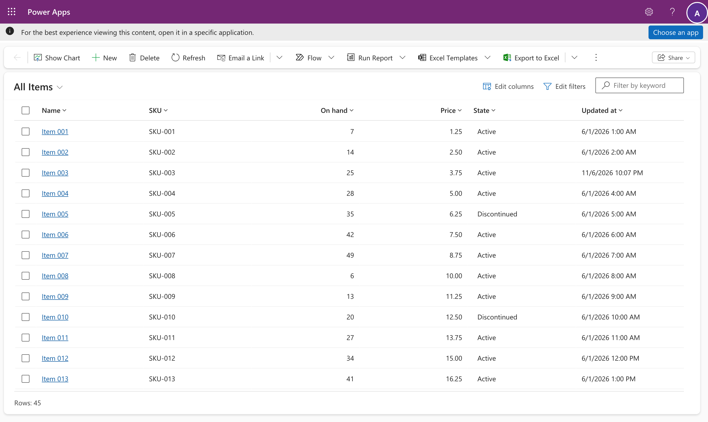
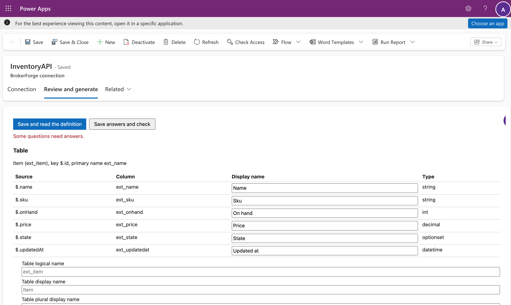
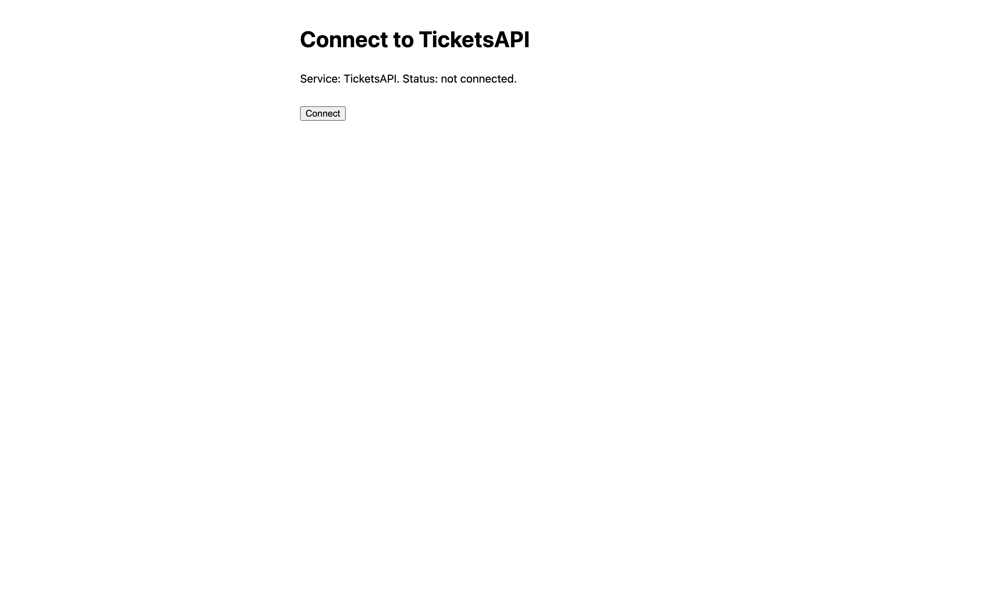

# BrokerForge

BrokerForge puts REST APIs into Microsoft Dataverse as virtual tables. An administrator adds a connection in the BrokerForge app, pastes the API's OpenAPI (Swagger) definition and answers a few questions about it. Generate then makes the table, its columns, a form, a view and a security role, and operations that aren't simple reads and writes become Custom APIs. There's no code, YAML or redeploy per source.

It follows the K2 model: a service broker exposes a source as SmartObjects; BrokerForge exposes it as Dataverse tables.



| K2 | BrokerForge |
| --- | --- |
| Service broker | Adapter for one kind of source (REST today) |
| Service instance | A connection: base URL, authentication, the API's definition and your answers |
| Service object | The endpoints BrokerForge found in the definition |
| SmartObject | A virtual table for list, read, create, update and delete, plus a Custom API per other operation |
| K2 server | The BrokerForge host, an ASP.NET Core service on Azure Container Apps |

## How it works

A Dataverse plug-in turns each table or Custom API call into a request to the host, signed with a token from Power Platform's managed identity, so the plug-in holds no secret. The host checks the token, finds the connection's approved design, builds the source call, authenticates it and maps the answer back to rows.

Where the definition leaves a gap, such as how results are paged or which filters the API really supports, BrokerForge asks rather than guessing, and an endpoint isn't used until its questions are answered.



Two rules run through the design. It fails loudly: a filter or sort the API doesn't declare is refused with a named error, never filtered in the browser, and an unmapped error from the source comes back with a correlation ID. And a source that runs as each user never falls back to a service account: a user who hasn't connected gets a link to connect.

### Authentication

| Mode | The source sees |
| --- | --- |
| Static | An API key in a header or query parameter, or HTTP Basic. Keys are kept encrypted by the host and set on its own page, never in Dataverse |
| Service account | A token for an Entra ID app, from the host's managed identity |
| OAuth | Each user's own account at the source, connected once on the host's connect page |
| Impersonate | Each user's own Entra ID identity, through the on-behalf-of flow |
| SSO | Built and covered by contract tests; not yet tried against a real source |



## Status

Version 0.1.0 handles REST sources. Four sources run on it in the dev environment: an Orders and an Inventory API with API keys, and two Tickets APIs where each user sees their own rows, one connected through OAuth and one through Entra ID. Connections move between environments as Dataverse solutions; each environment sets its own base URL and key.

Some things are deliberately left to a person. Dataverse doesn't let an application user create Custom APIs, so creating a source's actions and its security role is an administrator's step, done on the host's page while signed in as that administrator. SQL, OData, SOAP and GraphQL adapters, response caching and throttling are planned, not built.

## Install

[docs/install.md](docs/install.md) installs BrokerForge into one Dataverse environment and one Azure resource group with one script. It needs an Azure subscription, permission to create Entra ID app registrations, and System Administrator in the environment.

## Documentation

- [How-to guide](docs/guide/how-to-guide.md): adding a connection and connecting your account, with screenshots. A Word copy and a 5-minute video are attached to each [release](https://github.com/SimonAllport/Broker-Forge/releases).
- [Connection design format](docs/connection-design-format.md) and [operation descriptor specification](docs/descriptor-spec.md): what Generate produces and the host runs.
- [Findings]: what each build phase verified live, including the platform limits it ran into.

## Building and testing

The solution needs the .NET 10 SDK (projects target .NET 8, and .NET Framework 4.6.2 for the plug-in) and Node 22 for the mock APIs.

```bash
dotnet build BrokerForge.slnx
dotnet test BrokerForge.slnx            # starts the mock APIs and Azurite through npx
cd tools/mock-api && npm test
node --test 'tests/webresources/*.test.js'
```

The contract tests run every descriptor feature against the mock APIs; CI runs all of the above on each push.

## Licence

[MIT](LICENSE)
